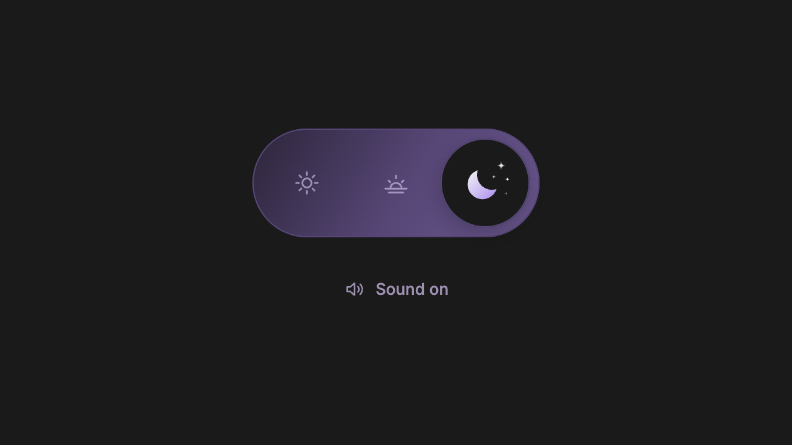

# Theme switcher

A three way theme switch for Light, Sunset and Dark. Each stop has its own animated sun, sunset or moon, and a soft sound plays on each switch, which you can turn off.

**[Try it live](https://lucybichakhchyan.github.io/theme-switcher/)**

## How it is built

The page is `index.html`, with styles in `style.css` and the switch in `script.js`. It uses plain HTML, CSS and JavaScript with no libraries. The browser makes the sounds with the Web Audio API, so there are no sound files.

## License

The code is available under the [MIT License](LICENSE).
